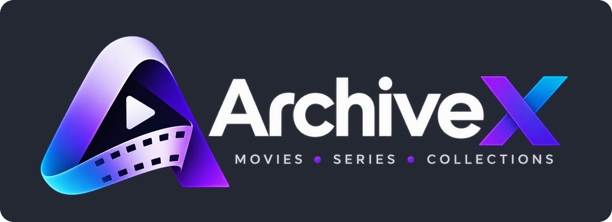
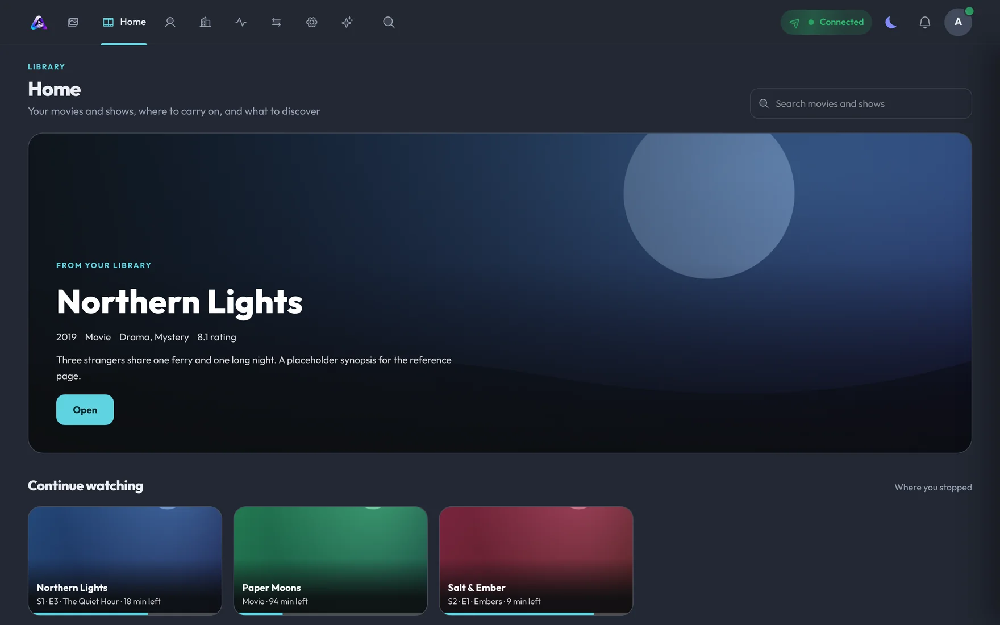
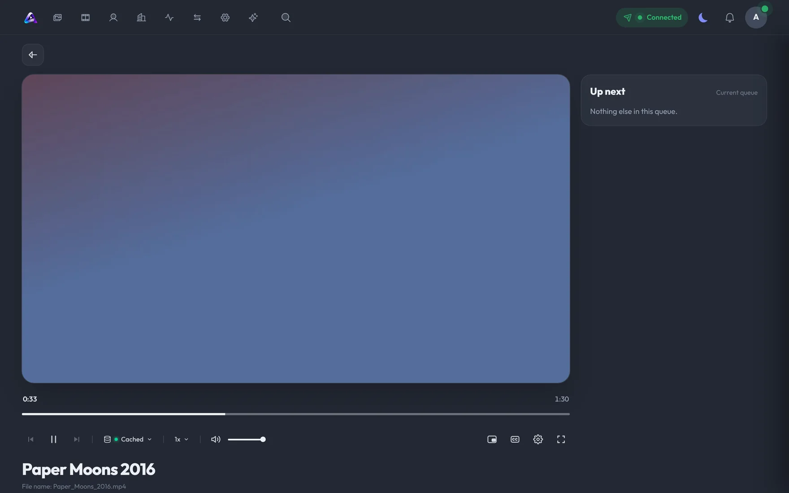
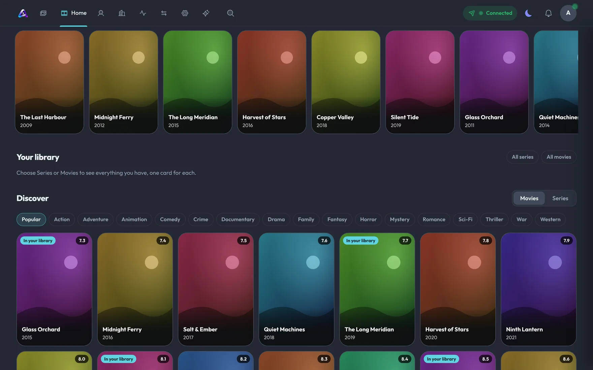
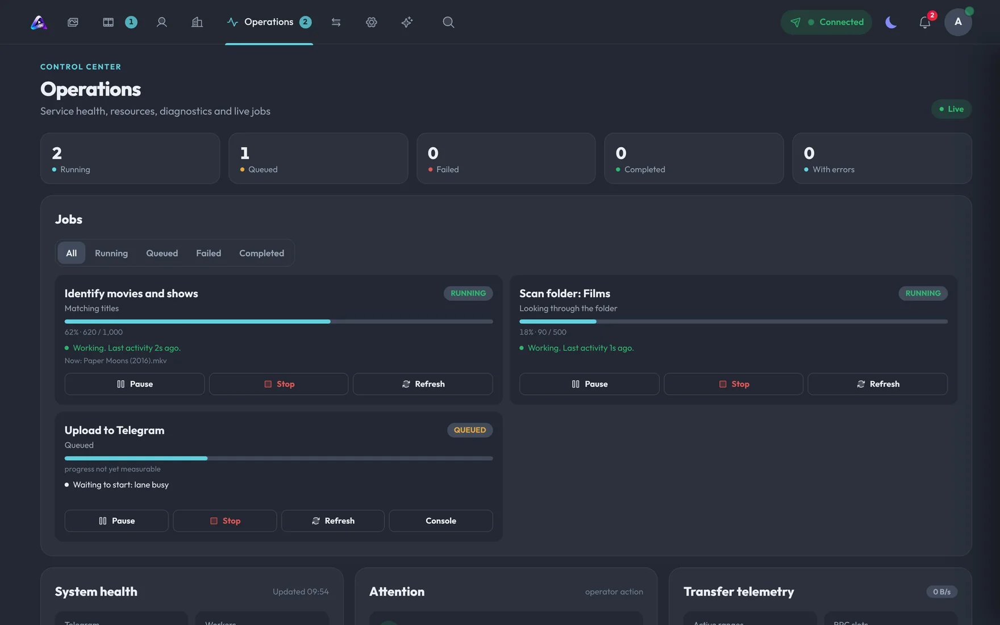
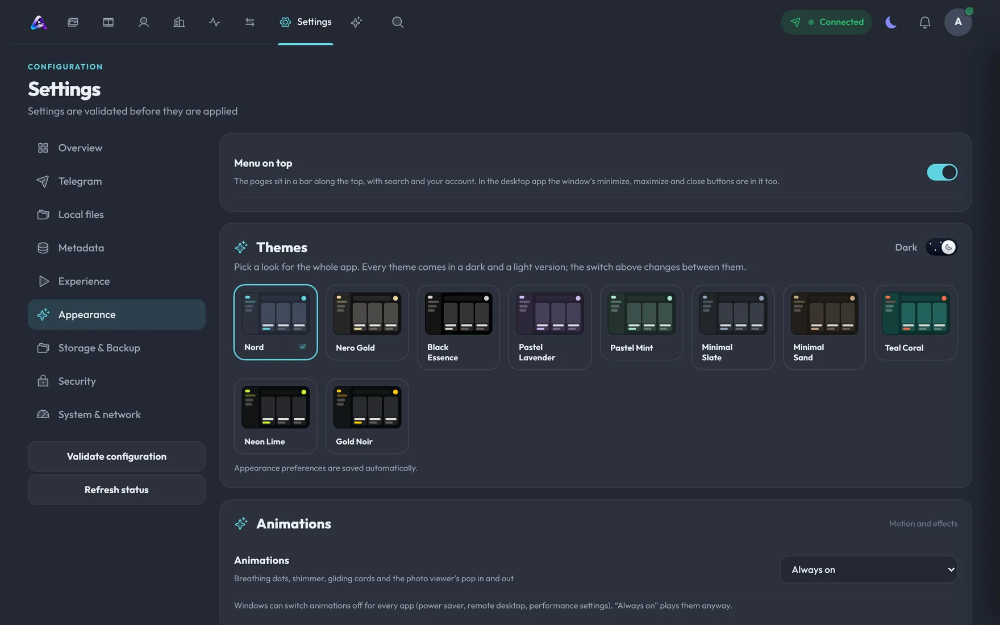

<p align="center"></p>

<h1 align="center">Archive X</h1>

<p align="center"><b>A private, local-first media library for your Telegram channels and your own folders.</b><br>
Browse, search and play movies, series, videos and photos from one Windows desktop app.</p>

<p align="center">
<a href="https://github.com/Abithdas/Archive-X/releases/latest"></a>

<a href="LICENSE"></a>
<a href="CHANGELOG.md"></a>
</p>

<p align="center"></p>

<p align="center"><a href="https://htmlpreview.github.io/?https://github.com/Abithdas/Archive-X/blob/main/docs/ui-reference/index.html"><b>See every screen: the UI reference</b></a> (placeholder titles; open it in a browser, click a picture to enlarge)</p>

> **Note**
> Archive X is a personal project I made for my own use and decided to share. It was built with the help of [Claude Code](https://www.anthropic.com/claude-code), Anthropic's AI coding assistant. It isn't affiliated with Telegram, Anthropic or any of the metadata providers it can look names up in.

## Install

| | |
| --- | --- |
| **Windows 10 and 11 (x64)** | [**Download the latest release**](https://github.com/Abithdas/Archive-X/releases/latest): choose `Archive-X_…_x64-setup.exe` (normal installer) or `…_x64.msi` (Windows Installer package). |

The app updates itself: **Settings → Overview** checks for new versions and installs them. Older versions are on the [releases page](https://github.com/Abithdas/Archive-X/releases).

### First run

1. **Sign in to Telegram** when asked. Your session is stored encrypted on this PC.
2. **Choose what is in the library:** *Settings → Telegram → Channels* (new channels stay out until you mark them), and *Settings → Local files* to add folders from your PC. Files in folders are read where they lie, never copied.
3. **Name your movies and shows:** nothing to set up. Cinemeta (no key) is on by default; add a free **TMDB** key in *Settings → Metadata* for the best results.

## Read this first

- **It runs on your PC.** The library, caches and settings never leave it. Telegram is used only to read and move channel media. Metadata services see only the titles and names you ask the app to identify, and each can be switched off.
- **Two modes, one switch.** The app opens in **SFW** every time: movies and shows, nothing adult anywhere (pages, counts, search, links). **NSFW** is behind the switch in the profile menu and can be locked with an optional PIN. A login for the app is optional too.
- **Windows only for now.** The video engine and installer are built for Windows x64.

## What you get

**Home and Discover (movies and shows).** One page for what is yours and what to find next: a billboard from your library, *Continue watching*, *Airing this week*, *Recently added*, your series and movies as one card each (never one per episode), and **Discover** with popular titles by genre, a search, and a details window. Titles you already own are marked.

**Plays anything.** A player with 36 preview frames under the timeline, resume, scene markers, speed, captions and picture-in-picture. Files a browser cannot play start in a **native player** (hardware decoding) that works the same way, with the same controls and keys.

**One library, many sources.** Telegram channels and folders on your PC sit side by side. Each is marked in or out of the library, SFW or NSFW. Move or rename a file in a folder and it keeps its name, favourite and resume point.

**Knows what you have.** Titles are identified from file names and fingerprints (TMDB, OMDb, TVmaze, Cinemeta, OpenSubtitles). Cast and studios get their own pages with pictures; a person's page lists movies and shows, not episodes.

**Photos and people.** Photo galleries with face grouping: name a person, remove wrong pictures in bulk, choose their picture, add a photo to someone from the photo's menu.

**Moves and automates.** Send videos between channels, or upload a folder to a channel, keeping what was already identified. An **Operations** page shows running work and logs; RSS and qBittorrent automation and an optional local AI assistant are built in.

<table>
<tr>
<td width="50%"><br><sub><b>Player</b>: preview frames, buffer status, captions, up next</sub></td>
<td width="50%"><br><sub><b>Discover</b>: popular titles by genre; yours are marked</sub></td>
</tr>
<tr>
<td width="50%"><br><sub><b>Operations</b>: running work, health and logs</sub></td>
<td width="50%"><br><sub><b>Themes</b>: ten looks, each in dark and light</sub></td>
</tr>
</table>

## Build from source

<details>
<summary>Requirements and commands</summary>

Rust stable, Node.js 22, Python 3.12, and optionally [`just`](https://github.com/casey/just) (it runs the same commands as CI).

```bash
just test && just lint
```

Without `just`:

```bash
python -m pip install -r requirements.txt pytest httpx websockets
python -m pytest tools/tests -q
cargo test --workspace
cd apps/web && npm ci && npm test && npm run typecheck && npm run unused
```

The Windows installer is built by the [Desktop workflow](.github/workflows/desktop.yml), which publishes a release when run with a version number.
</details>

## Project layout

| Path | What it is | Made with |
| --- | --- | --- |
| `apps/web/` | The interface shown in the window | TypeScript, React 19, Vite, Tailwind |
| `apps/desktop/` | The desktop shell: starts and stops everything, updates | Rust, Tauri 2 |
| `crates/` | Front door, database access, performer names, face learning, launcher, native player wrapper | Rust |
| `telegram_archive/` | Telegram, jobs, metadata, playback cache, content modes | Python (FastAPI, Telethon, SQLite) |
| `native/axplayer/` | The native video engine | C++ |
| `packaging/`, `tools/`, `docs/` | Installer tooling, tests and release scripts, architecture and plans | Python, shell, Markdown |

Start with [docs/architecture.md](docs/architecture.md). The reasons for the big choices are in [docs/adr/](docs/adr/README.md), and the plan is in [docs/plan.md](docs/plan.md).

## Credits

- Movie and TV data: [TMDB](https://www.themoviedb.org/) (*this product uses the TMDB API but is not endorsed or certified by TMDB*), [TVmaze](https://www.tvmaze.com/) (CC BY-SA 4.0), [OMDb](https://www.omdbapi.com/), [OpenSubtitles](https://www.opensubtitles.com/) and the open [Cinemeta](https://github.com/Stremio/stremio-addon-sdk) catalogue of the Stremio project.
- Third-party components and their licences: [THIRD-PARTY-NOTICES.md](THIRD-PARTY-NOTICES.md).

## Contributing and licence

Bug reports and ideas are welcome in [Issues](https://github.com/Abithdas/Archive-X/issues); see [CONTRIBUTING.md](CONTRIBUTING.md) for the workflow. Archive X is licensed under the [GNU General Public License v3 or later](LICENSE).
